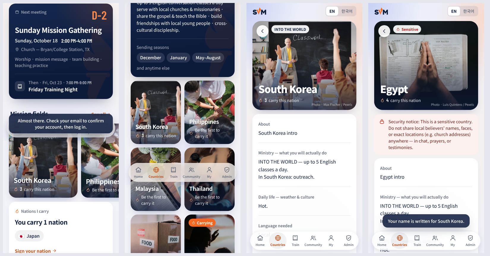

# SVM — Student Volunteer Movement

브라이언–컬리지 스테이션 학생자원운동(SVM) 사이트 하나에 세 부분이 들어 있습니다.

| 주소 | 내용 |
|---|---|
| [`/`](https://koreayjk.github.io/svm/) | **SVM 홈페이지** — 운동 소개(1886), 비전 영상, Mobilize·Train·Send, 가려는 학생/맞이하는 선교지, 7개 선교지, 앱 소개, 누가 이끄나, 함께하는 3가지 방법, FAQ |
| [`/conference/`](https://koreayjk.github.io/svm/conference/) | **미션 컨퍼런스 2026** (11/20 금, 오후 6시 입장) — 그날 밤 순서, 텐트 빌리지, FAQ, **등록 폼** |
| [`/app/`](https://koreayjk.github.io/svm/app/) | **SVM 앱** (PWA) — 가입, 선교지, 내 나라에 이름 쓰기, 이벤트, 관리자 · `app/?demo` 는 실제 DB와 분리된 체험 모드 |

세 곳 모두 루트의 `config.js`(Supabase URL + anon key)를 함께 씁니다.

## SVM 앱

브라이언/컬리지 스테이션 학생자원운동(SVM) 선교 지원 플랫폼 — **Mobilizing · Training · Sending**
명세서: [`docs/SVM_App_Spec_v2.md`](docs/SVM_App_Spec_v2.md) (현행) · [v1](docs/SVM_App_Spec.md) · 목표: 2026-11-20 발족식

## 현재 상태 — 1단계 완료 (명세 v2 반영)

| 항목 | 상태 |
|---|---|
| Supabase 스키마 (전체 9개 기능 + 이름 쓰기) · RLS · 7개국 시드 · 관리자 지정 SQL | ✅ |
| 브랜드: 공식 로고(`assets/`), Navy `#0D1B3A` · Orange `#F26722`, Noto Sans KR + Barlow Condensed | ✅ |
| 이메일 로그인 / 회원가입(이름·이메일·비밀번호만) / 비밀번호 재설정 | ✅ |
| 회원 등급 (member · graduate · admin) + 배지 | ✅ |
| i18n (EN / 한국어 토글, 프로필에 저장) | ✅ |
| 하단 탭: Home · Countries · Train · Community · My · Admin(관리자만) | ✅ |
| 홈: 다음 주일 미션 게더링(매주 오후 2–4시), 내가 품은 나라, 핵심 컨셉 5가지 | ✅ |
| 나라 목록·상세: 5개 섹션, 제공/준비 고정 블록, 파송 시즌, INTO THE WORLD, 민감 국가 배너 | ✅ |
| **2단계** ① 현지 사진 갤러리 — 관리자 업로드(1600px로 자동 축소, Storage `country-photos`)·삭제 | ✅ |
| **2단계** ② 나라방 채팅 — 참여/나가기(신청과 별개), Realtime, 안 읽은 메시지 수, 관리자 메시지 삭제, 이름은 "이름 + 성 이니셜" | ✅ |
| **2단계** ⑦ 신청 — 트랙(단기/중기/장기)·파송 시즌 안내·출발일·기간, 상태 타임라인, 사역 중 연장 신청 | ✅ |
| **2단계** 관리자 신청 탭 — 상태별 필터, 상태·귀국 예정일·메모 변경, 연장 승인/반려, 명단 CSV 내보내기 | ✅ |
| **내 나라에 이름 쓰기** — 품은 사람 수 + "이름 성이니셜" 목록 (민감 국가는 숫자만) | ✅ |
| 관리자: 회원 등급 변경, `require_graduation_to_apply` / 민감국가 사진 차단 설정, 국가 민감도·노출 on/off | ✅ |
| PWA (manifest + service worker, 홈 화면 설치) | ✅ |
| **3단계** ③ 언어 훈련 — 복음 메시지를 듣기·따라하기(반복 횟수)·가리기(반/전부)·자가 테스트, 속도·쉬는 시간·무한 반복, 녹음 우선·없으면 브라우저 음성, 숙달도·연속 학습일 | ✅ |
| **3단계** 선교 교육 — 유튜브 강의 + 소감 제출로 완료, 리더 답글 · 수료 — 필수 강의 + 언어 자가 테스트 통과 시 신청 → 관리자 승인 → 수료 회원 | ✅ |
| **3단계** 관리자 훈련 탭 — 수료 요청(강의·언어·연습일 요약)·승인, 소감 답글, 강의 추가·수정, 나라별 복음 메시지 문장 편집 | ✅ |
| **4단계** ⑤ 주일 미션 게더링 — 홈에서 셀프 체크인(모임 30분 전~끝난 뒤 30분, DB 함수 `self_check_in`), 출석 기록·연속 주, 말씀·나눔 노트 · 관리자 모임 생성·출석부 | ✅ |
| **4단계** ⑥ 간증 — 작성(사진 3장, 민감 국가 사진 차단)·승인제·홈 추천·나라별 모아보기 · ⑧ 기도 제목 — 기도했어요(1인 1회)·응답됨→간증 쓰기 | ✅ |
| 알림 — 헤더 종(신청·연장·수료·간증·후원 결과, 리더 답글, 팀 추가; DB 트리거 `notify_changes`가 만들고 Realtime 으로 바로 표시) · 하단 커뮤니티 탭에 안 읽은 채팅 수 | ✅ |
| 관리자 첫 화면 처리할 일 요약·탭 배지 · 신청서 내부 메모(`application_notes`, 관리자만) · 회원 이름은 서버에서부터 "이름 + 성 이니셜"(`profile_names`) | ✅ |
| 관리자 편집 — 나라 페이지(소개·사역·생활·언어·숙식·추가 항목, 나라 추가), 이벤트, 복음 메시지 녹음(앱에서 녹음·파일) | ✅ |
| **4단계** ⑨ 준비물 체크리스트(공통 + 신청 나라)·후원 사연(승인 후 공개, https 링크만) · ④ 팀 — 게시판·할 일(담당자·상태·마감일), 관리자가 팀 구성 | ✅ |

## 디자인 시스템



브랜드 가이드(명세 v2 §2) 위에 **Apple 스타일의 절제 + 파스텔 그라데이션 배경** 방향으로 정리했습니다. 모든 값은 `app/index.html` 상단 `:root` 토큰에 있습니다.
- **배경:** 브랜드 색을 옅게 푼 라벤더(네이비 계열) → 피치(오렌지 계열) 그라데이션, 고정 레이어
- **카드:** 테두리 없는 반투명 흰 카드 + 옅은 그림자 (`card()` 헬퍼) · 홈 통계는 피치/라벤더 색 타일
- **선교지 카드:** 사진형 카드 (`destCard()`) — `country_photos` 에 사진이 있으면 첫 장, 없으면 임시 기본 사진(`assets/countries/`, 출처는 [docs/PHOTO_CREDITS.md](docs/PHOTO_CREDITS.md)), 그것도 없으면 파스텔 그라데이션 + 큰 국기
- **목록:** iOS 설정 앱 같은 그룹 리스트 — 네이비 아이콘 + 아이콘 뒤에서 시작하는 가는 구분선
- **글자:** 큰 제목은 자간을 좁게, 본문은 기본값 · 라벨은 문장형 회색 캡션 · Barlow Condensed 는 숫자 전용
- **버튼:** 캡슐형, 누르는 순간 즉시 반응 (`:active` scale .97)
- **크롬:** 스크롤하면 반투명해지는 상단 바, 떠 있는 반투명 탭바, iOS 세그먼트 컨트롤·스위치
- **모션:** 짧은 페이드-업(8px)만, 튀는 효과 없음 · `prefers-reduced-motion / -transparency / -contrast` 대응

## 파일 구조

```
index.html             SVM 홈페이지 (EN/KO)
conference/index.html  미션 컨퍼런스 2026 + 등록 폼
app/index.html         앱 전체 (단일 파일, Vanilla JS)
app/manifest.webmanifest, app/sw.js   PWA 매니페스트 · 서비스 워커 (앱 셸 캐시)
config.js              Supabase 연결 정보 (anon key 만)
assets/site.css, site.js   홈페이지·컨퍼런스 공통 스타일·스크립트 (언어 전환, 세계지도, D-day)
assets/                공식 로고 SVG, 세계지도 점, 나라 사진, 앱 화면(screens/), 컨퍼런스 사진(images/)
icons/                 앱 아이콘 (로고 기반)
landing.html           예전 주소 → 홈페이지로 이동
sql/01_스키마.sql       테이블 · 트리거
sql/02_RLS.sql          헬퍼 함수 · RLS 정책 · Realtime · Storage 버킷
sql/03_국가_시드.sql     7개국 · 기본 설정(제공/준비 항목·파송 시즌) · 공통 준비물 · 주일 미션 게더링
sql/04_관리자_지정.sql   관리자 지정
```

## 홈페이지 · 컨퍼런스
- 문구는 영어가 HTML 에, 한국어는 각 페이지 아래 `window.KO` 에 있습니다 (`data-k` 키로 연결).
- 선교지는 7개국(한국·필리핀·말레이시아·태국·멕시코·일본·이집트). 이집트는 민감 국가.
- 컨퍼런스 등록 → `conference_registrations` 테이블. 공개(anon)는 넣기만 가능하고, **조회는 관리자만** 됩니다.
  같은 이메일은 한 번만 등록됩니다. 명단 보기: Supabase **Table Editor → conference_registrations** (CSV 내보내기 가능).
  `config.js` 가 비어 있으면 폼은 "온라인 등록 곧 오픈" 안내를 보여 줍니다.
- 공유용 빌드: `python3 tools/build_site_artifact.py out.html <앱 링크>`
- 앱 화면이 바뀌면 스크린샷을 다시 찍어 `assets/screens/{화면}-{en|ko}.jpg` 를 교체하세요.

## 데모 모드 (바로 시연)
`config.js` 에 Supabase 정보가 없거나 주소 끝에 `?demo` 를 붙이면(`app/?demo`) **데모 모드**로 동작합니다 — 백엔드 없이 전체 흐름을 시연할 수 있습니다.
- 브라우저 안의 가짜 DB (7개국, 11/20 컨퍼런스, 예시 회원·이름 쓰기 포함), 데이터는 그 기기에만 저장
- 아무 이메일로 가입 가능 (이메일 인증 없음) · **그 기기에서 처음 가입한 계정이 관리자** → 관리 탭 시연 가능
- 마이 탭의 **데모 데이터 초기화** 로 처음 상태로 되돌리기
- Supabase URL/anon key 를 넣으면 자동으로 실제 운영 모드로 전환
- 시연 링크용 단일 페이지 빌드: `python3 tools/build_demo_artifact.py out.html` (파일 저장·공유 버튼 제외)

## 설치 순서

### 1. Supabase 프로젝트
1. [supabase.com](https://supabase.com) 에서 새 프로젝트 생성
2. **SQL Editor** 에서 순서대로 실행: `01_스키마.sql` → `02_RLS.sql` → `03_국가_시드.sql`
   (현재 프로젝트: `uafdrygbaloqffhwcebc`)
   (모두 여러 번 실행해도 안전합니다)
3. **Authentication → URL Configuration**
   - Site URL: `https://koreayjk.github.io/svm/app/`
   - Redirect URLs 에도 같은 주소 추가 (이메일 인증·비밀번호 재설정 링크용)

> **발족식 현장(3분 흐름) 팁:** Supabase는 기본적으로 가입 시 이메일 인증을 요구합니다. 현장에서 바로 둘러보게 하려면
> **Authentication → Providers → Email → Confirm email** 을 끄세요 (보안이 약간 느슨해지는 대신 가입 즉시 로그인). 켜 둬도 앱은 정상 동작합니다.
>
> **v1 SQL 을 이미 실행했다면:** 01 → 02 → 03 을 다시 실행하면 v2 로 업그레이드됩니다 (새 컬럼 추가, 중국은 삭제하지 않고 숨김 처리).

### 2. 연결 설정
루트의 `config.js` 에 **Project Settings → API** 의 값을 넣습니다 (홈페이지·컨퍼런스·앱이 함께 사용).
```js
window.SVM_CONFIG = {
  SUPABASE_URL: 'https://xxxx.supabase.co',
  SUPABASE_ANON_KEY: 'eyJhbGciOi...',
};
```
anon key 는 공개용 키입니다. 데이터 보호는 RLS 가 담당합니다 (service_role 키는 절대 넣지 마세요).

### 3. GitHub Pages
Repository **Settings → Pages** → Source: `Deploy from a branch`, Branch: `main` / `/ (root)`

### 4. 관리자 지정
1. 배포된 앱에서 관리자 계정으로 회원가입 (이메일 인증 완료)
2. `sql/04_관리자_지정.sql` 의 이메일을 바꿔 SQL Editor 에서 실행
3. 앱 새로고침 → 하단에 **Admin** 탭이 나타남

## 보안 설계 메모 (RLS)

- `profiles.role` 은 트리거로 보호 — 일반 회원은 본인 등급을 바꿀 수 없음
- 후기·후원 사연은 회원이 `status`/`featured` 를 보내도 항상 `pending` 으로 저장
- 신청서는 본인·관리자만 조회, 상태 변경은 관리자만. 상태 변경 이력은 `application_status_history` 에 자동 기록
- `require_graduation_to_apply` 가 켜지면 DB 단에서 수료 회원 외 신청 차단
- 연장 신청은 `on_field` 상태에서만 가능, 승인 시 `expected_return` 자동 갱신
- 수료 요청 승인 시 자동으로 `graduate` 등급 부여
- 셀프 출석 체크는 게더링 시간(America/Chicago, 앞뒤 30분)에만 허용
- 민감 국가 + `sensitive_photo_block` 이면 후기 사진 저장 차단
- 채팅 작성자 이름은 `profile_names` 뷰로만 노출 (이메일·전화번호 비공개)
- 이름 쓰기: `nation_pledges` 원본 행은 본인·관리자만 조회. 다른 사람은 `nation_pledge_counts`(숫자)와
  `nation_pledge_names`(이름+성 이니셜, **민감 국가 제외**) 뷰로만 봄

## 명세 대비 추가한 컬럼/테이블
- `countries.*_ko` (국가 콘텐츠 한국어판), `countries.extra_sections` (관리자 추가 항목), `extra_provided_ko`
- `room_members.last_read_at` (안 읽은 메시지), `application_status_history` (신청 타임라인)
- `language_progress.correct_count / wrong_count`, `practice_days` (연속 학습일)
- `testimonies.prayer_id` (응답된 기도 → 간증 연결), `*.reviewed_at`

## 이벤트 (컨퍼런스·발족식 등)
매주 모임(`gatherings`)과 별도로 `events` 테이블에서 관리합니다. 11/20 SVM 미션 컨퍼런스는 시드에 들어 있습니다.
- `is_featured = true` → 홈 맨 위 큰 배너 (D-day 카운트다운)
- 나머지 다가오는 이벤트 → 홈 "다가오는 이벤트" 목록 (최대 3개) → "모두 보기"로 전체 목록
- 상세 화면: 일시·장소·소개, `link_url` 이 있으면 등록 버튼, **캘린더에 추가**(.ics), 공유
- 시간이 정해지지 않았으면 `all_day = true` → "시간 추후 안내"로 표시
- 숨기기: `is_published = false` · 지난 이벤트는 자동으로 사라짐
- 관리 → 이벤트에서 추가·수정·숨기기 (시간은 브라이언/컬리지 스테이션 기준으로 입력)

## 확인이 필요한 값
- 11/20 컨퍼런스 장소: 지금은 "오후 6시 입장 · venue announced soon" 입니다 (`events` 행, `conference/index.html`, 홈페이지 문구 수정).
- 정기 모임은 매주 주일 오후 2–4시 미션 게더링 하나입니다 (금요 모임 없음). 시간은 `app/index.html` 의 `DEFAULTS.gatherings.sunday`.
- 국가별 소개·생활 문구는 초안입니다. 실제 내용으로 교체하세요.

## 다음 단계 (5단계, ~11/18)
실제 콘텐츠 입력(나라 사진, 검수된 복음 메시지 번역, 강의 영상), 발족식 현장 흐름 리허설(QR → 가입 → 이름 쓰기 → 신청 3분), 전체 테스트, PWA 설치 테스트

> 3단계 메모: 복음 메시지는 **예시 번역**(5문장 × 7개 언어, `tools/gospel_sample.py`)입니다. 현지 사역자가 검수한 문장으로
> 관리 → 훈련 → 복음 메시지 문장에서 바꾸세요. 같은 화면에서 문장마다 **바로 녹음**하거나 파일을 올리면(Storage `audio`) 브라우저 음성 대신 재생됩니다.
> 언어 자가 테스트 "통과" = 한 나라의 모든 문장을 자가 테스트에서 한 번 이상 맞힘.

> 2단계 메모: 신청서의 `admin_note` 는 신청자에게 보이는 메모, `application_notes` 는 관리자만 보는 내부 메모입니다.
> 나라방 채팅은 Supabase Realtime 을 씁니다 (`02_RLS.sql` 이 `messages` 를 publication 에 추가).
